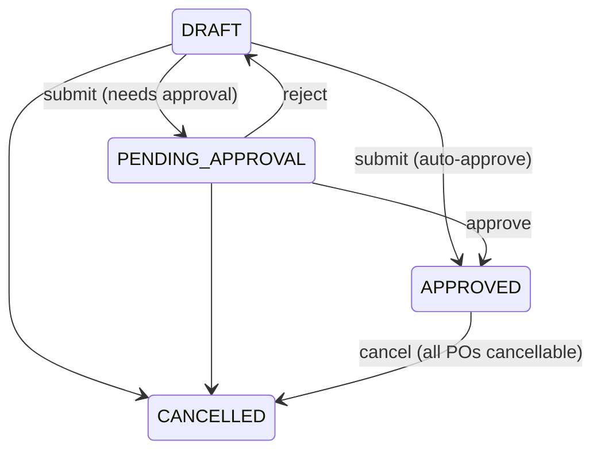

# Order Forms (OF)

An Order Form is the master document for one whole supplier order across every branch: one row per product, one column per branch. A purchaser keys it as a draft. Submitting splits it into one OF per department. Each OF is then approved by an approver, or approved at once when the policy says no approval is needed. Approval gives it its permanent number. Printing the approved OF (from the Print page) generates one PO per branch with a positive allocation and issues them. Until the POs exist the OF itself can be amended; after that, changes go through the branch POs and flow back into the OF. In the business flow, this area is the **order → approval** stage. Everything downstream (warehouse, blind counts, DMs/CSs/IPs, checks) hangs off the POs it generates and off `of_id`.

## Files

| File | Role | Key public names |
|---|---|---|
| `atlaspo/order_forms.py` | OF lifecycle service, no Qt | `create_draft`, `update_draft`, `submit_order`, `submit`, `approve`, `reject`, `generate_pos`, `cancel`, `can_cancel`, `amend`, `decide_amendment`, `get_of`, `search`, `counts`, `pending`, `pending_amendments`, `rejections`, `approval_history`, `audit_trail`, `amendments`, `approval_amount`, `term_base`, `format_of_number`, `active_branches`, `clean_date`, `label`, `NEXT_*` constants |
| `atlaspo/of_layout.py` | Admin-chosen order of OF header fields and grid columns (layout only, never data) | `FIELDS`, `LEADING`, `AFTER`, `BRANCHES`, `COLUMNS`, `field_order`, `column_order`, `save` |
| `atlaspo/ui/of_page.py` | Screens | `OFPage` (one OF with its allocation grid), `OrdersPage` (work list), `InquiryPage` (read-only lookup), `DocumentPanel`, `may_approve`, `EnterMoves`, `DepartmentGrid` |
| `atlaspo/orders.py` (shared) | Helpers this module relies on | `write_guard`, `policy`, `needs_approval`, `require_listed_approver`, `next_po_number`, `clean_line`, `LINE_FIELDS`, status constants, `sync_parent_of` |

## Data model

Tables are created in `MIGRATE_V2` (`schema.py` ~line 365). Guards were added later in `MIGRATE_V28` (~line 1726). `SCHEMA_VERSION = 28`.

- **`order_forms`**: header (`HEADER_FIELDS`, `order_forms.py:25`), `status`, `of_number`/`of_year`/`of_seq` (all NULL until approval; CHECKs keep them NULL or set together; `APPROVED` requires a number), `supplier_snapshot` (supplier row as JSON, frozen at approval), stored totals (`total_qty_m`, `total_pieces_m`, `gross_c`, `item_discount_c`, `overall_discount_c`, `vat_c`, `grand_total_c`), `revision`, `prepared_by`, `approved_by`, `approval_date`, `auto_approved`, `pos_generated_at/by`, `cancelled_at/by`, `cancel_reason`.
- **`order_form_items`**: one row per product. It holds `orders.LINE_FIELDS` plus `net_unit_c`, `total_qty_m`, `line_gross_c`, `line_discount_c` and `line_total_c`. `line_no` is unique per OF. `product_id` stays NULL until approval links it to the catalog.
- **`order_form_allocations`**: `(of_item_id, branch_code, qty_m)`, unique per item and branch. Rows with qty 0 can exist after `sync_parent_of`, and readers skip them.
- **`of_number_sequences`**: `(year, last_number)`. Triggers `of_sequence_never_backward` and `of_sequence_no_delete` apply.
- **`of_amendments`**: `status IN (PENDING_APPROVAL, APPLIED, REJECTED)`, `before_json`, `after_json`, `revision` (unique per OF), plus who requested and who decided it. Once decided, a row can't change or be deleted (`of_amendment_decided_stays`/`_no_delete`, V28).
- **`of_approvals`**: append-only (`of_approvals_no_update` and `_no_delete`). `decision IN (SUBMITTED, APPROVED, AUTO_APPROVED, REJECTED)`. Amendment rows carry an `amendment_id`. The policy's `basis`, `threshold_c` and `policy_enabled` are recorded on each row.
- **`purchase_orders`** (written by `generate_pos`): `ux_po_of_branch` (one PO per OF per branch) and `ux_po_year_branch_seq`; `po_requires_approved_of` refuses a PO for an OF that isn't APPROVED.
- `audit_logs.of_id` ties audit rows to the OF.

**Lock triggers** (V2): `of_terms_locked` (money and terms columns, `revision`, totals), `of_items_locked_*` and `of_alloc_locked_*` reject changes once `status <> 'DRAFT'` unless a `po_write_guard` row exists. Also `of_number_fixed` and `of_no_delete_numbered` (only an unnumbered DRAFT can be deleted). V28 adds `of_status_path`, `of_approval_fixed` (approver and date fixed once past PENDING), `of_pieces_locked` and `of_pos_generated_fixed`.

**Status path** (`of_status_path`, enforced in the DB unless `write_guard` is held):

Derived (not stored): `delivery_status()`, `register_tab()` (OPEN / COMPLETED / CANCELLED from PO statuses and `unsent`), `next_step()` and `draft_is_old()` (draft untouched for more than `DRAFT_WARN_DAYS = 7` days; a warning only).

Settings read: `approval.enabled`, `approval.threshold_c` (default 10000000 = ₱100,000), `approval.comparison` (GT/GTE), `approval.approver_user_ids`, `approval.allow_self_approval`, `approval.basis` (`OF_TOTAL` or `LARGEST_BRANCH`), `tax.vat_rate_bp`, `layout.of_fields`, `layout.of_columns`.

## Rules enforced

Permissions (`auth.PERMISSIONS`): `of.edit`, `of.cancel`, `of.amend` and `of.generate` belong to ADMIN and BUYER. `of.approve` belongs to ADMIN and APPROVER. `settings.edit` is ADMIN only.

1. **One supplier per OF, and it must be ACTIVE.** Enforced in `_clean_header` (create/update/amend) and again in `generate_pos`. Uses `of.edit` / `of.amend` / `of.generate`.
2. **Every OF is VAT-free for now.** `_clean_header` forces `vat_mode = VAT_NONE` whatever is passed in (`order_forms.py:181`). The schema default is still `'INCLUSIVE'`.
3. **Allocations only to active `kind='BRANCH'` branches.** `_check_branches_active` runs on create, update, submit, amend and generate.
4. **Numeric safety limits.** `MAX_AMOUNT_C`, `MAX_TOTAL_C`, `MAX_PIECES`, `MAX_PIECES_PER_UNIT` and `MAX_FX_RATE_M` (`_check_line_numbers`, `_clean_item`, `_clean_header`, `_totals`). The order qty (in pieces) must equal the branch quantities × `pieces_per_unit`.
5. **Each SKU belongs to one supplier.** `masters.check_skus` runs on save. New SKUs join the catalog only on approval (`_record_new_products` → `masters.record_products`), so drafts and rejected OFs leave nothing behind. Approval (and an applied amendment) also sets each existing product's catalog cost to the line's net unit cost; cancelling an APPROVED OF calls `masters.recost_after_cancel` so its prices don't stay behind.
6. **Submit needs at least one product, and every row needs a positive total that equals its allocations.** Enforced in `submit`.
7. **One department per OF.** `submit_order` splits a multi-department draft into one OF per department, all in one transaction (the lowest department keeps the original id). `amend` refuses to add a department; older multi-department OFs keep theirs.
8. **Approval is judged on the whole order.** `approval_amount` uses the OF total, or the largest branch under `LARGEST_BRANCH`. For a split order, every part is judged on the whole order's amount (`judge_on`). `orders.needs_approval` → `money.requires_approval` (GT strictly above the threshold, GTE at or above; a disabled policy never requires approval).
9. **An OF that waited once always waits again.** If a non-amendment `SUBMITTED` row exists in `of_approvals` (it was rejected back to Draft, or it is a split part), `submit` sends it to PENDING regardless of amount (`order_forms.py:438`).
10. **Submitting for approval needs an approver to be set.** Otherwise: "No approver is set…" (`submit`, `amend`).
11. **Separation of duties** (`_check_approver`): the user needs `of.approve` **and** must be on `approval.approver_user_ids` (`orders.require_listed_approver`, so an ADMIN not on the list can't approve). Unless `allow_self_approval` is on, the preparer can't approve or reject, and for OF decisions (not amendments) nor can anyone with an `OF_CREATE/OF_MODIFY/OF_ALLOCATION_CHANGE/OF_SUBMIT/OF_SPLIT` audit row on that OF. The UI mirrors this with `may_approve` and `ApprovalsPage._may_decide_amendment`.
12. **Rejecting needs a reason.** This applies to `reject` and to `decide_amendment(approved=False)`.
13. **OF numbers are given at approval only.** `_next_number` runs inside the approval transaction, using the year of approval (not `of_date`). Numbers are never reused (sequence triggers, `of_number_fixed`).
14. **POs are generated once, from an APPROVED OF, with no OF amendment pending and an active supplier.** A repeat call returns the existing POs (`pos_generated_at` check). The `ux_po_of_branch` index and the `po_requires_approved_of` trigger back this up. Uses `of.generate`.
15. **Amend only an APPROVED OF whose POs don't exist yet, with one pending amendment at most.** The supplier and `of_date` never change. An amendment with no change is refused. A change to `internal_notes` alone is applied directly with no revision (`OF_NOTES`). Uses `of.amend`.
16. **An amendment needs approval when** the policy is enabled and it raises any branch's per-piece quantity, adds a row, raises the per-piece cost, lowers `disc1_bp`/`disc2_bp`, changes `payment_terms`, the overall discount or other charges, or raises the grand total. Otherwise it is auto-applied (`AUTO_APPROVED` row).
17. **Cancel needs a reason.** It is refused while any OF or PO amendment is pending, or if any PO is PARTIAL, FULL or CLOSED. Each live PO goes through `orders.cancel(..., sync_of=False)`, which also refuses counted, charged or paid POs (needs `po.cancel`). Numbers stay used. Uses `of.cancel`.
18. **Locked documents.** Past DRAFT, the OF header money and terms, items and allocations change only inside `orders.write_guard` (DB triggers).

## Main flows

- **Create or update a draft.** `create_draft` / `update_draft` → `require("of.edit")` → `tx` → `_clean_header`, `_clean_item`, `_check_branches_active`, `check_skus`, `_totals`. Writes: INSERT/UPDATE `order_forms`; items and allocations are deleted and re-inserted on every save (`_delete_items` + `_insert_items`, so item ids change); `_store_totals`. Audit: `OF_CREATE`; `OF_MODIFY` (before/after snapshot); `OF_ALLOCATION_CHANGE` when branch quantities moved. Update refuses anything not in DRAFT.
- **Submit.** `submit_order` → if there is one department, `submit`. Otherwise it splits: `other_charges_c` and (for AMOUNT only) `overall_discount_value` are split by each department's `line_total_c` with `money.split_by_weight` (largest remainder); a PERCENT discount is copied as is. Part 0 is `update_draft`, the rest are `create_draft`. Audit `OF_SPLIT` on the original, then `submit(..., judge_on=whole_order)` for each part. `submit` either sets PENDING (+ `of_approvals SUBMITTED`, audit `OF_SUBMIT`) or calls `_make_approved(auto=True)` (+ `AUTO_APPROVED`, audit `OF_AUTO_APPROVE`).
- **Approve.** `approve` → status PENDING → `_check_approver` → `_make_approved`: link new products, `_next_number`, set status, number, approver, `approval_date`, `auto_approved` and `supplier_snapshot`. Then an `of_approvals APPROVED` row with the amount from the last SUBMITTED row (`_submitted_amount`). Audit `OF_APPROVE`.
- **Reject.** `reject` → status PENDING → `_check_approver` → back to DRAFT, `of_approvals REJECTED` with the reason, audit `OF_REJECT`. The number is not given.
- **Generate POs.** `generate_pos` (called by `pdf.print_order_form` from the Print page, and by `sample_data`). Inside `write_guard`, for each branch code in sorted order: `orders.next_po_number(year, code)`; INSERT `purchase_orders` with status APPROVED, the branch's `overall_shares[code]` stored as a peso `DISC_AMOUNT`, and `charge_shares[code]`; lines carry `of_item_id` and `of_allocation_id`; `orders.store_totals`; `orders._record_approval` with "Inherited from <OF>". Audit `PO_GENERATE` per PO, then `pos_generated_at/by` and audit `OF_GENERATE_POS`.
- **Amend.** `amend` → validation → build `before`/`after` → INSERT `of_amendments` (PENDING) → either `of_approvals SUBMITTED` + audit `OF_AMEND_REQUEST`, or `_apply_amendment` + `AUTO_APPROVED`. `_apply_amendment` (under `write_guard`): `record_products`, rewrite the header (not supplier or date), re-insert items, store totals, `revision += 1`, amendment set to APPLIED with that revision. Audit `OF_AMEND` (and `OF_ALLOCATION_CHANGE`). `decide_amendment` → `_check_approver(requested_by)` → apply (+ `APPROVED` row), or REJECTED (+ row, audit `OF_AMEND_REJECT`). It refuses to apply if the OF is no longer APPROVED or its POs already exist.
- **Cancel.** `cancel` → checks (rule 17) → `orders.cancel` per live PO → OF CANCELLED with the reason. Audit `OF_CANCEL`.
- **After generation**, PO amendments and cancels call `orders.sync_parent_of`, which rewrites OF allocations and totals from the live POs (audit `OF_SYNC`). A PO revision also bumps `order_forms.revision` (`orders.py` ~789).

## Screens

- **Orders** (`OrdersPage`, sidebar Purchasing → Orders). Tabs Open / Recently completed (30 days) / Cancelled. Uses `of_service.search` and lists legacy POs alongside. One click expands an OF to its POs; a side `DocumentPanel` previews the order. The **Next step** button (`_next_action`) shows "Open and finish" (needs `of.edit`), "Review and approve" (only if on the approver list and `may_approve`), "Decide the amendment" (goes to Approvals) or "Go to Print" (needs `po.issue`). Cancel from the list is offered only for DRAFT/PENDING with `of.cancel`. "New order form" is shown only with `of.edit`. Export to Excel (`reports.of_register_excel`). Ctrl+O opens, Esc closes the panel; Ctrl+Shift+N (main window) starts a new OF.
- **OF screen** (`OFPage`). A workflow strip (Draft, Approval, Approved, Branch POs, Issued), a header panel ordered by `of_layout.field_order`, and department tabs (choosing one filters the rows and sets the department of new rows). A catalog completer adds products. Tabs: Branch allocation, Branch POs, History (`audit_trail`). Buttons per status (`_build_actions`):
  - DRAFT with `of.edit`: Cancel OF (existing draft only), Save draft (`create_draft`/`update_draft`), Save and submit (save, then `submit_order`; a split shows a summary box).
  - PENDING: Cancel OF (`of.cancel`); Reject / Approve only when `may_approve`.
  - APPROVED: Cancel OF if `can_cancel`; Amend if POs aren't generated and the user has `of.amend` (the supplier and OF date stay disabled); Warehouse OF PDF (`pdf.warehouse_of`, asks before a reprint).
  - CANCELLED with a number: Warehouse OF PDF.
  - Read-only OFs replace the input boxes with two plain "facts" lines.
- **Keyboard on the OF screen:** Enter moves along the visible, editable columns in on-screen order (the `EnterMoves` delegate plus `advance`). After the last branch column it goes to the **SKU column** of the next visible row and adds a row at the end. Delete clears a cell. Ctrl+S presses the primary save; Ctrl+N adds a row; Esc means Go back (asks first if the screen is dirty). Live totals use `money.compute_order` in `_recalculate`. `_approval_note` says whether approval is needed and how many OFs a submit will make.
- **Inquiry** (`InquiryPage`, Records → Inquiry): read-only, numbered OFs only. Modes: Find an OF / All OFs / OFs by date. The stage shown is derived from POs and checks.
- **Approvals** (`ui/pages.py` `ApprovalsPage`) calls `pending`, `pending_amendments`, `rejections`, `approve`, `reject` and `decide_amendment`. **Print** (`pages.py` `PrintPage` → `common.print_order_forms` → `pdf.print_order_form`) is the only UI route that generates POs.
- **Settings, Order Form layout** (`settings_page.py`) → `of_layout.save` (`settings.edit`).
- Role reach: Orders, Approvals and Print are in every non-limited sidebar. RECEIVER-only, ACCOUNTING-only and WAREHOUSE-only users get no Purchasing pages (`main_window.py` ~219–237). VIEWER sees the pages with no action buttons.

## Money and numbers

- Money is integer centavos, percents are basis points, quantities are thousandths (`qty_m`). Units go through `money.m_to_qty` / `qty_to_m`.
- **Line amounts** (`_clean_item`): `compute_line` is run **per branch allocation** and summed, so the OF row totals equal the sum of the PO rows exactly. `net_unit_c` = `round(unit_cost × (1−d1)(1−d2))`. Rounding is `ROUND_HALF_UP` (`money.round_centavos`).
- **Order totals** (`money.compute_order`): the overall discount (PERCENT on merchandise after item discounts, or an AMOUNT) and other charges are split across branches by merchandise value (`split_by_weight`, largest remainder). VAT is computed per branch. The OF total is the sum of its branch totals.
- **`get_of` extras (display/payment only, never stored):** `sticker_deduction_c = round(total_pieces × supplier.sticker_rate_c)`; `term_discount_c = round(term_base × term_discount_bp / 10000)`, where `term_base` excludes other charges and VAT added on top (and claim stubs when passed in); `net_payable_c = grand_total − stickers − term discount`. The supplier values come from `supplier_snapshot` once the OF is approved.
- **Numbering:** OF `YYYY-OF-NNNNN` (`format_of_number`), with one sequence per year, given at approval. PO `YYYY-<branch_code>-NNNNN` (`orders.format_po_number`), with one sequence per branch per year, given at generation. Drafts take no number; a draft is labelled "Draft OF #id".

## Interactions with other modules

- **Calls:** `masters` (`check_skus`, `record_products`, `clean_terms`), `orders` (`write_guard`, `policy`, `needs_approval`, `require_listed_approver`, `next_po_number`, `insert_items`, `store_totals`, `_record_approval`, `cancel`, `can_cancel`, `clean_line`), `money`, `db` (`tx`, `audit`, `get_setting`, `now`/`timestamp`).
- **Called by:** `pdf.print_order_form` (generate, then issue in a second transaction), `pdf.warehouse_of`/`office_of`/renderers (`get_of`), `reports` (`search`), `ui/pages.py` (Approvals, Print), `ui/settings_page.py` (`of_layout`), `sample_data`, and downstream modules through `of_id` (payments `payment_check_ofs` / `payment_differences`, receiving via `of_item_id` / `of_allocation_id`).

## Tests

- `tests/test_fix_order_forms.py`: split rounding, recorded approval amounts, `LARGEST_BRANCH`, branch filter query, notes-only and no-change amendments, number limits, dates.
- `tests/test_acceptance.py`: department split, approval limit, self-approval, rejection, amendments before generation, drafts consume no numbers.
- `tests/test_review_fixes.py` (a rejected split part waits again), `tests/test_audit_fixes.py` (`test_f18`: an approver who rewrote a draft can't approve it), `tests/test_rules_discount.py`, `tests/test_rules_gate.py`.
- UI: `tests/test_ui.py` (grid, departments, Enter, cancel from list, old drafts), `tests/test_fix_of_lists.py`, `tests/test_fix_of_print_approvals.py`, `tests/test_fix2_approvals-print.py`, `tests/test_rules_paging_orders.py`.
- Run from `apps/desktop`, with `PO_DATA_DIR` and `PO_SAMPLE_DIR` set to temp folders first: `python -E -m pytest tests/test_fix_order_forms.py -q -p no:cacheprovider`

## Gotchas for changing this module

- **`write_guard` is required** for any write to a non-DRAFT OF's terms, totals, revision, items or allocations, and for status moves off the allowed path. It raises `RuntimeError` outside a transaction. Don't remove triggers to make a write pass; a trigger error means the write is a business-rule violation.
- **`update_draft` deletes and re-inserts items**, so item and allocation ids are only stable after approval. POs point to them through `of_item_id` / `of_allocation_id`, which is why items past DRAFT are locked.
- **`tx` nests by joining** (`db.tx` yields when already in a transaction), so `submit_order` calling `update_draft`, `create_draft` and `submit` is all one transaction. An error anywhere rolls back the whole split.
- **`of_approvals` and decided `of_amendments` are append-only.** "Waited before" and `_submitted_amount` are read from this history, so never "clean it up".
- **The approval amount recorded for a split part is the whole order's amount**, not the part's own total. The audit summary for `OF_APPROVE` shows the part's own `grand_total_c`. This is deliberate.
- **The VAT override** in `_clean_header` silently ignores the passed `vat_mode`. The UI shows the stored mode only for non-drafts.
- **`generate_pos` commits on its own** before `print_order_form` issues in a second transaction. If issuing fails, the POs exist (APPROVED, unissued) and the OF can no longer be amended at OF level; changes go through the POs.
- **`decide_amendment` calls `_check_approver` without `of_id`**, so the "worked on this OF" audit check (rule 11) does not apply to OF amendments. Only `requested_by` is compared. The UI's `_may_decide_amendment` matches this.
- **Cancel from the Orders list is limited** to DRAFT/PENDING. An APPROVED OF is cancelled from the OF screen only (when `can_cancel`). On a DRAFT, the OF screen's Cancel button is gated by `of.edit` rather than `of.cancel` (both are ADMIN/BUYER today).
- **`OFPage.generate()` and `OFPage.make_office_pdf()` have no button** (see the comment in `_build_actions`: POs come from Print, and the Final/office OF from Payments). Don't assume they are reachable.
- **Error text** (`POError`) is shown to users verbatim, so keep the plain purchasing wording.
- **The layout settings tolerate stale values:** `of_layout._ordered` drops unknown names and appends new ones. Adding a column means adding it to `LEADING`/`AFTER` and to `OFPage._layout_columns`.
